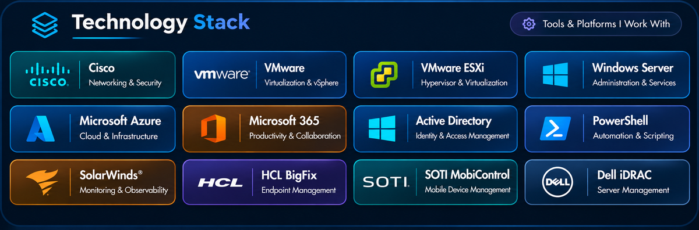

Windows Server | Virtualization | Cloud | Networking | Security

Additional Platforms & Skills

IT Infrastructure | Enterprise Networking | Systems Administration
View My Projects

---
About Me
I am an IT Infrastructure Specialist with experience in enterprise networking, Windows Server administration, VMware virtualization, identity and access management, and enterprise IT systems.
My work includes infrastructure administration, technical troubleshooting, system deployment, endpoint management, monitoring, and documentation.
This GitHub portfolio contains technical guides, illustrative configuration examples, administration notes, and troubleshooting procedures related to technologies I work with.
My focus is on reliable infrastructure, practical problem-solving, secure administration, and continuous technical development.
---
Core Technical Skills
Technical Area	Technologies and Skills
Windows Infrastructure	Windows Server, administration, services, patching, PowerShell
Virtualization	VMware vSphere, vCenter, ESXi, clusters, datastores
Cloud and Productivity	Microsoft Azure administration concepts, Microsoft 365, Cloudflare, Google administration
Network Infrastructure	Cisco Catalyst, VLANs, IP addressing, SNMPv3
Network Monitoring	SolarWinds, Cisco Catalyst Center, alerts
Identity and Access	Active Directory, Adaxes, security groups, Group Policy
Endpoint Management	SOTI MobiControl, HCL BigFix
Endpoint Security	SentinelOne administration 
Enterprise Applications	Application deployment, SQL connectivity, SMTP
Industrial IT	COT T8000 printer support
Server Hardware	Dell PowerEdge, iDRAC, server lifecycle management
IT Operations	Incident management, monitoring, troubleshooting, documentation
---
Certifications & Professional Training

Training or Study Area	Focus
Cisco CCNA	Routing, switching, networking
Microsoft Azure AZ-104	Azure administration
Google System Administrator	Google administration and IT operations
IBM IT Support	Technical support and troubleshooting
Network Security	Network security fundamentals
SentinelOne Admin Training	Endpoint security administration
Software Testing	Quality assurance and testing
These entries describe training and knowledge areas, not verified certification exam passes. Credentials should be stated separately when verified.
---
Featured Infrastructure Projects
Network Infrastructure
Project	Focus
Cisco Catalyst Switch Configuration	Switch administration and troubleshooting
Cisco VLAN and IP Management	VLAN and addressing concepts
Cisco SNMPv3 and SolarWinds	Secure monitoring concepts
Cisco Catalyst Center Monitoring	Access point and device monitoring
VMware Virtualization and Server Hardware
Project	Focus
VMware vSphere VM Deployment	VM deployment and verification
VMware Cluster and Datastore	Cluster and storage administration
ESXi Host Management	ESXi host operations
Dell iDRAC Server Management	Hardware health and remote management
Identity and Access Management
Project	Focus
Active Directory User Management	Account administration
Adaxes User Provisioning	Provisioning workflows
Active Directory Security Groups	Permissions and group membership
Group Policy Management	GPO processing and troubleshooting
Enterprise Systems
Project	Focus
Microsoft 365 License Management	Licensing and user administration
Enterprise Application Integration	SQL, SMTP, application dependencies
Enterprise Application Deployment	Deployment and validation
Endpoint, Industrial IT and Windows Server
Project	Focus
SOTI MobiControl Device Management	Mobile device administration
COT T8000 Industrial Printer Management	Industrial printer support
Windows Server Administration	Windows services and troubleshooting
Infrastructure Operations and Monitoring
Project	Focus
Windows Server Patching	Patch planning and verification
HCL BigFix Endpoint Management	Fixlets, patch actions and compliance
SolarWinds Infrastructure Monitoring	Server and network monitoring
Network Troubleshooting Guide	Connectivity, VLAN, DNS, DHCP
Server Lifecycle Management	Deployment, maintenance, retirement
Enterprise IT Infrastructure Operations	Operations, scripts, documentation
Repository links should be checked against the exact names on GitHub; some repositories may use different capitalization or naming.
---
Infrastructure Troubleshooting
Network connectivity, VLANs, switching and SNMPv3
ESXi hosts, virtual machines and datastore alerts
Windows Server services, updates and event logs
Active Directory permissions and Group Policy
Microsoft 365 account and licensing issues
SQL Server and SMTP connectivity
Enterprise application deployment
SOTI MobiControl device management
Industrial printer connectivity
BigFix endpoint patching and monitoring alerts
Server hardware, iDRAC and lifecycle operations
---
GitHub Activity

---
Portfolio Documentation and Security
This portfolio demonstrates technical knowledge, illustrative administration workflows, and infrastructure troubleshooting approaches.
All published examples should be fictional or sanitized. Never publish real internal IP addresses, production switch configurations, credentials, private hostnames, confidential company documentation, security secrets, or sensitive infrastructure details.
---

Explore My Infrastructure Portfolio
View All Repositories
Windows Server | Virtualization | Cloud | Networking

